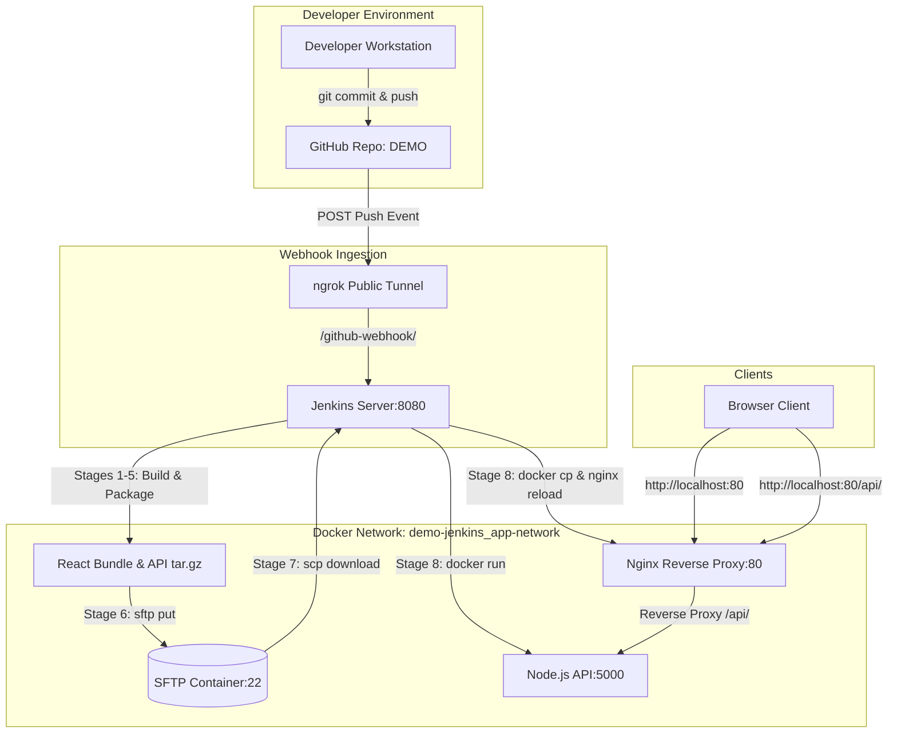

# Complete Project Documentation & End-to-End Setup Guide
## React + Node.js + Jenkins CI/CD + SFTP + Nginx + Docker

---

## 1. Executive Summary & What We Built

We designed and built an automated, production-grade **Continuous Integration & Continuous Deployment (CI/CD)** pipeline using **Jenkins**, containerized with **Docker Compose**, with **SFTP artifact storage** and an **Nginx reverse proxy**.

### The Flow at a Glance:
```
Developer (git push)
        │
        ▼
 GitHub Repository
        │ (Webhook via ngrok)
        ▼
Jenkins Controller (Docker)
  ├── 1. Checkout Git SCM
  ├── 2. Parallel Install (Node.js API & React App)
  ├── 3. Parallel Automated Tests
  ├── 4. Parallel Build (React Production Bundle + Docker Images)
  ├── 5. Package Artifacts (.tar.gz)
  ├── 6. Upload Artifacts to SFTP Server
  ├── 7. Download Artifacts from SFTP Server (Validation)
  ├── 8. Deploy:
  │      ├── Deploy React HTML bundle into Nginx container
  │      ├── Zero-downtime Nginx reload (`nginx -s reload`)
  │      └── Restart updated Node.js API container
  └── 9. Post-Deployment Automated Health Checks
        │
        ▼
End User Access: http://localhost:80 (React UI + /api proxy)
```

---

## 2. System Architecture



---

## 3. Directory Structure

```text
Demo-jenkins/
├── docker-compose.yml          # Orchestrates all 5 microservices
├── Jenkinsfile                 # 9-stage declarative CI/CD pipeline
├── .gitignore                  # Ignores node_modules, build outputs, and env files
│
├── node-api/                   # Express.js REST API
│   ├── Dockerfile
│   ├── index.js
│   └── package.json
│
├── react-app/                  # React Frontend Application
│   ├── Dockerfile
│   ├── nginx.conf              # Production Nginx for frontend container
│   ├── package.json
│   ├── public/
│   │   └── index.html
│   └── src/
│       ├── App.js
│       ├── App.css
│       └── index.js
│
├── nginx/                      # Main Edge Reverse Proxy
│   └── nginx.conf              # Routes / to React HTML & /api/ to Node API
│
└── sftp/                       # Secure File Transfer Protocol Service
    └── users.conf              # User definitions (sftpuser)
```

---

## 4. Complete Step-by-Step Setup from Scratch

### Phase 1: Prerequisites
Ensure the following tools are installed on your host system:
1. **Docker Desktop** (with WSL2 enabled on Windows)
2. **Node.js** (v18 or v20+) and **npm**
3. **Git**
4. **ngrok** (for tunneling GitHub webhooks to your local machine)

---

### Phase 2: Create Project Files

#### 1. Node.js API (`node-api/`)
- **`node-api/package.json`**:
```json
{
  "name": "node-api",
  "version": "1.0.0",
  "main": "index.js",
  "scripts": {
    "start": "node index.js",
    "test": "echo \"Tests passed\" && exit 0"
  },
  "dependencies": {
    "cors": "^2.8.5",
    "dotenv": "^16.3.1",
    "express": "^4.18.2"
  }
}
```

- **`node-api/index.js`**:
```javascript
const express = require('express');
const cors = require('cors');
require('dotenv').config();

const app = express();
const PORT = process.env.PORT || 5000;

app.use(cors());
app.use(express.json());

app.get('/', (req, res) => {
  res.json({
    message: 'Hello World from Node.js API! 🚀',
    timestamp: new Date().toISOString(),
    environment: process.env.NODE_ENV || 'development',
    build: process.env.BUILD_NUMBER || 'local'
  });
});

app.get('/health', (req, res) => {
  res.status(200).json({
    status: 'OK',
    uptime: process.uptime(),
    timestamp: new Date().toISOString()
  });
});

app.listen(PORT, '0.0.0.0', () => {
  console.log(`Node API running on port ${PORT}`);
});
```

- **`node-api/Dockerfile`**:
```dockerfile
FROM node:18-alpine
WORKDIR /app
COPY package*.json ./
RUN npm ci --only=production
COPY . .
EXPOSE 5000
CMD ["npm", "start"]
```

---

#### 2. React Application (`react-app/`)
- Create React app structure with `src/App.js` fetching from `/api`:
```javascript
import React, { useEffect, useState } from 'react';
import axios from 'axios';
import './App.css';

function App() {
  const [apiData, setApiData] = useState(null);
  const [status, setStatus] = useState('connecting');

  useEffect(() => {
    // Requests /api which is proxied by Nginx to Node.js backend
    axios.get('/api')
      .then(res => {
        setApiData(res.data);
        setStatus('connected');
      })
      .catch(() => setStatus('offline'));
  }, []);

  return (
    <div className="app">
      <div className="container">
        <div className="badge">🚀 CI/CD Demo</div>
        <h1>Hello World! React + Node + Jenkins</h1>
        <div className={`status-card ${status}`}>
          <span>API Status: <strong>{status.toUpperCase()}</strong></span>
        </div>
      </div>
    </div>
  );
}
export default App;
```

- **`react-app/Dockerfile`**:
```dockerfile
# Multi-stage build
FROM node:18-alpine AS builder
WORKDIR /app
COPY package*.json ./
RUN npm ci
COPY . .
RUN npm run build

FROM nginx:alpine
COPY --from=builder /app/build /usr/share/nginx/html
COPY nginx.conf /etc/nginx/conf.d/default.conf
EXPOSE 80
CMD ["nginx", "-g", "daemon off;"]
```

---

#### 3. SFTP Configuration (`sftp/users.conf`)
```text
sftpuser:sftppassword:1001:1001:upload,upload/artifacts,upload/builds
```

---

#### 4. Nginx Reverse Proxy (`nginx/nginx.conf`)
```nginx
worker_processes auto;
events { worker_connections 1024; }

http {
    include /etc/nginx/mime.types;
    default_type application/octet-stream;

    upstream node_api {
        server node-api:5000;
        keepalive 32;
    }

    server {
        listen 80;
        server_name _;
        root /usr/share/nginx/html;
        index index.html;

        # React SPA Routing
        location / {
            try_files $uri $uri/ /index.html;
        }

        # Reverse Proxy to Node.js API
        location /api/ {
            proxy_pass http://node_api/;
            proxy_http_version 1.1;
            proxy_set_header Host $host;
            proxy_set_header X-Real-IP $remote_addr;
        }

        # Health Check
        location /health {
            return 200 '{"status":"ok","service":"nginx"}';
            add_header Content-Type application/json;
        }
    }
}
```

---

#### 5. Docker Compose (`docker-compose.yml`)
```yaml
services:
  node-api:
    build:
      context: ./node-api
    container_name: node-api
    ports:
      - "5000:5000"
    networks:
      - app-network
    restart: unless-stopped

  react-app:
    build:
      context: ./react-app
    container_name: react-app
    ports:
      - "3000:80"
    networks:
      - app-network
    restart: unless-stopped

  sftp:
    image: atmoz/sftp:latest
    container_name: sftp-server
    ports:
      - "2222:22"
    volumes:
      - ./sftp/users.conf:/etc/sftp/users.conf:ro
      - sftp-data:/home/sftpuser/upload
    networks:
      - app-network

  jenkins:
    image: jenkins/jenkins:lts-jdk17
    container_name: jenkins
    ports:
      - "8080:8080"
      - "50000:50000"
    volumes:
      - jenkins_data:/var/jenkins_home
      - /var/run/docker.sock:/var/run/docker.sock
    networks:
      - app-network

  nginx:
    image: nginx:alpine
    container_name: nginx-proxy
    ports:
      - "80:80"
    volumes:
      - ./nginx/nginx.conf:/etc/nginx/nginx.conf:ro
      - nginx-html:/usr/share/nginx/html
    networks:
      - app-network

volumes:
  jenkins_data:
  sftp-data:
  nginx-html:

networks:
  app-network:
    name: demo-jenkins_app-network
```

---

### Phase 3: Launch Containers & Initialize Jenkins

1. Start all containers:
   ```powershell
   docker-compose up -d --build
   ```

2. Retrieve initial Jenkins admin password:
   ```powershell
   docker exec jenkins cat /var/jenkins_home/secrets/initialAdminPassword
   ```

3. Open `http://localhost:8080`, paste the password, select **Install suggested plugins**, and create your admin account.

4. Install Required Jenkins Packages inside the container:
   ```powershell
   # Install Docker CLI, Node.js, npm, sshpass
   docker exec -u 0 jenkins apt-get update
   docker exec -u 0 jenkins apt-get install -y docker.io nodejs npm sshpass
   docker exec -u 0 jenkins chmod 666 /var/run/docker.sock

   # Grant permissions on SFTP directory
   docker exec -u 0 sftp-server chown -R 1001:1001 /home/sftpuser/upload
   ```

5. Add SFTP Credentials in Jenkins:
   - Go to **Manage Jenkins** → **Credentials** → **System** → **Global credentials** → **Add Credentials**.
   - Kind: **Username with password**
   - Username: `sftpuser`
   - Password: `sftppassword`
   - ID: `sftp-credentials`
   - Click **Create**.

---

### Phase 4: Configure the Pipeline Job

1. In Jenkins: **New Item** → Name: `DEMO` → Select **Pipeline** → Click **OK**.
2. Under **General**:
   - Check **GitHub project**
   - Project url: `https://github.com/YOUR_USERNAME/DEMO/`
3. Under **Build Triggers**:
   - Check ✅ **GitHub hook trigger for GITScm polling**
4. Under **Pipeline**:
   - Definition: **Pipeline script from SCM**
   - SCM: **Git**
   - Repository URL: `https://github.com/YOUR_USERNAME/DEMO.git`
   - Branch Specifier: `*/main`
   - Script Path: `Jenkinsfile`
5. Click **Save**.

---

### Phase 5: Setup ngrok & GitHub Webhook

1. Start ngrok tunnel for Jenkins (port 8080):
   ```powershell
   ngrok http 8080
   ```
   *Note the public forwarding URL (e.g., `https://abc-123.ngrok-free.app`)*

2. Configure GitHub Webhook:
   - Go to GitHub repo → **Settings** → **Webhooks** → **Add webhook**
   - **Payload URL**: `https://<YOUR_NGROK_URL>/github-webhook/` *(Trailing slash is mandatory!)*
   - **Content type**: `application/json`
   - **Which events**: *Just the push event*
   - Click **Add webhook**.

---

## 5. Critical Issues Encountered & How They Were Solved

| Issue | Root Cause | Solution |
| :--- | :--- | :--- |
| **GitHub Webhook 403 Forbidden** | GitHub Payload URL was sent to root `/` without endpoint | Changed URL to `https://<ngrok-url>/github-webhook/` with trailing slash |
| **Jenkins Build #2 failed at startup** | `tools { nodejs 'NodeJS-18' }` failed because tool was undefined | Installed Node/npm natively in Jenkins container and removed strict tool requirement |
| **Docker not found in Jenkins** | Official Jenkins Docker image lacks `docker` client binary | Ran `apt-get install -y docker.io` inside Jenkins container and mounted `/var/run/docker.sock` |
| **SFTP `sshagent` error** | `sshagent` only supports SSH private keys, not username/password | Switched to `withCredentials([usernamePassword(...)])` and `sshpass` |
| **SFTP upload Permission Denied** | `/home/sftpuser/upload` volume was owned by `root:root` | Changed ownership with `docker exec -u 0 sftp-server chown -R 1001:1001 /home/sftpuser/upload` |
| **Welcome to nginx! on port 80** | Nginx HTML directory was empty until the first Deploy stage copied React build | Stage 8 copies `build` files with `docker cp` and executes `nginx -s reload` |
| **Health Check failure in Jenkins** | Jenkins tried to check `localhost:5000` which resolved to Jenkins container itself | Changed target URLs to Docker network hostnames: `http://node-api:5000/health` and `http://nginx-proxy/health` |

---

## 6. Verification & Day-to-Day Operations

### Manual Verification
- **Frontend**: Browse to `http://localhost:80`
- **Backend API**: Run `curl http://localhost:5000/health`
- **Nginx API Proxy**: Run `curl http://localhost:80/api`
- **SFTP Artifacts**: Run `docker exec sftp-server ls -lh /home/sftpuser/upload/artifacts`

### Continuous Deployment in Action
Whenever you make changes to React or Node.js:
```powershell
git add .
git commit -m "Update feature"
git push origin main
```
Jenkins will detect the webhook, automatically build, test, package, upload to SFTP, deploy to Nginx, and pass health checks.
